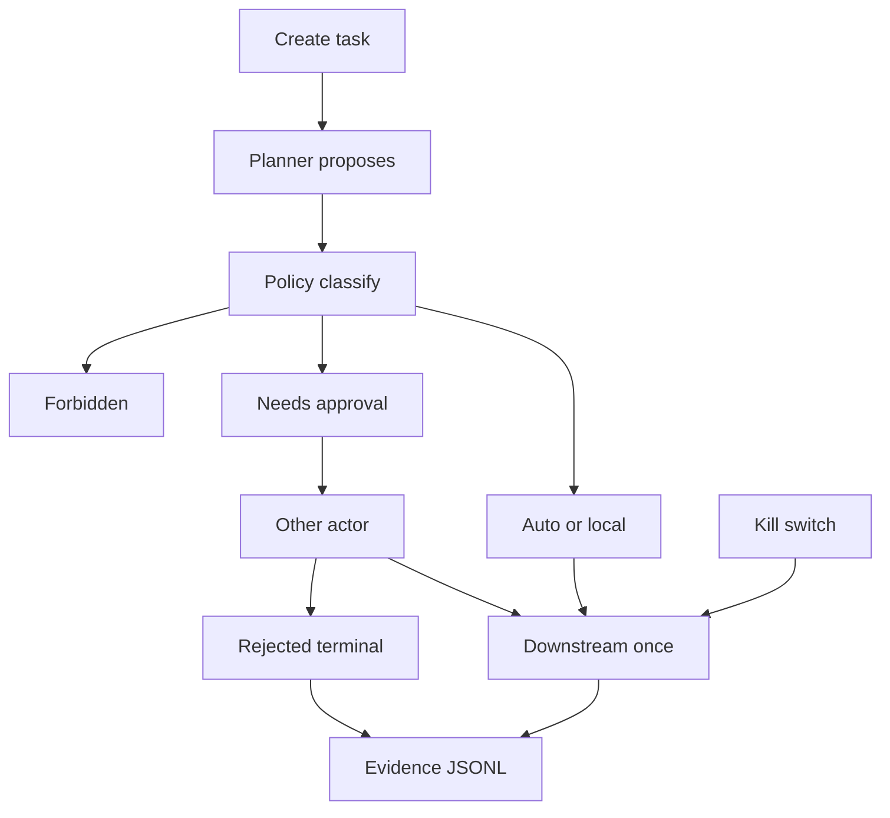

# Architecture

Local process. One fictional company. No hosted URL.

## What follows the public A2A notes

Read on 2026-10-18, not a conformance test:

- Specification: https://github.com/a2aproject/A2A/blob/main/docs/specification.md
- Task lifecycle: https://github.com/a2aproject/A2A/blob/main/docs/topics/life-of-a-task.md
- Agent discovery: https://github.com/a2aproject/A2A/blob/main/docs/topics/agent-discovery.md

Followed, in a small way:

- A card at `GET /.well-known/agent-card.json`.
- A task has an id and a context id.
- State names used here: `submitted`, `working`, `input-required`, `completed`, `failed`, `canceled`, `rejected`.
- Human approval is `input-required` with reason `approval-pending`. The public notes also describe `auth-required` for credentials. This lab does not implement that state.

Not followed:

- JSON-RPC 2.0, gRPC, and the official HTTP+JSON binding. The card says `protocolBinding: LAB-HTTP` so it does not claim those.
- Streaming, push notifications, signed cards, parts and artifacts as specified, multi-tenant routing.
- The JSON field names are a lab shape (`status.state`, `status.reason`). They are not a schema claim.

## Pieces

| Piece | Module | Role |
|---|---|---|
| Card | `src/a2a_gate/card.py` | Placeholder base URL from `PUBLIC_BASE_URL` |
| HTTP | `src/a2a_gate/http_api.py` | stdlib server, default bind `127.0.0.1` |
| Planner | `src/a2a_gate/planner.py` | Keyword fake, or one frozen cassette |
| Policy | `src/a2a_gate/policy.py` | YAML in `src/a2a_gate/data/nube_austral.yaml` |
| Runtime | `src/a2a_gate/runtime.py` | States, approval, idempotency, kill switch |
| Ledger | `src/a2a_gate/downstream.py` | Fake apply, bounded retries, dead letter |
| Evidence | `src/a2a_gate/evidence.py` | Append-only hash chain, field allowlist |
| Evals | `src/a2a_gate/evalkit/` | 37 cases plus one forced bypass |

## Amounts and keys

`issue_credit_note` uses `Record.amount_cents` from `src/a2a_gate/catalog.py`. A claim such as `amount_cents: "100"` on a 600000-cent invoice is ignored. The effect key is `{task idempotency key}:{action}:{record id}`, chosen by the runtime.

## Gate bypass

`Runtime(enforce_gate=False)` exists so `eval-regression` can show the invariant going red. `build_runtime` in `src/a2a_gate/wiring.py` always passes `enforce_gate=True`. There is no environment flag for it.
